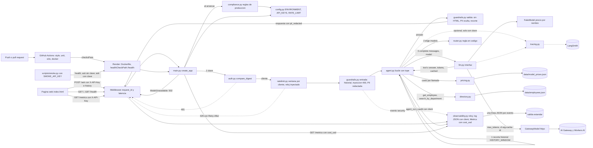

# Arquitectura del HR Assistant

API FastAPI sin estado con un agente que usa un modelo (interfaz) y dos herramientas de solo lectura.
La sesión 2 agrega observabilidad: id por petición, log JSON, métricas por proceso y trazas opcionales.
La sesión 3 agrega el modelo real por AI Gateway y cuatro palancas de costo: enrutamiento, ventana de historial,
tope de salida y caché del gateway.
La sesión 4 lo publica de forma segura: clave por cliente, límite de peticiones, compliance al arrancar,
contenedor, CI y Render.
El reto de producción agrega guardrails de entrada y salida (PII, secretos, inyección de prompt, saneado de la
respuesta), una prueba de carga para la concurrencia y la documentación de costos, seguridad y observabilidad.

## Decisiones

- 0001: API sin estado.
- 0002: modelo detrás de una interfaz.
- 0003: un solo agente con bucle acotado.
- 0004: id por petición y log JSON con reloj inyectado.
- 0005: métricas en memoria por proceso.
- 0006: trazas opcionales en LangSmith, ocultas por omisión.
- 0007: enrutamiento por regla en código.
- 0008: modelo real por AI Gateway y fallo como 502.
- 0009: costo por respuesta desde una tabla de precios.
- 0010: una clave por cliente en un encabezado.
- 0011: límite de peticiones en memoria, por proceso y con reloj inyectado.
- 0012: compliance como código que impide arrancar.
- 0013: guardrails de entrada y salida (PII, secretos e inyección de prompt).

## Flujo de comunicación

1. La página (o cualquier cliente HTTP) manda `POST /ask` con `X-API-Key`, la pregunta y el historial.
2. El middleware fija el `request_id` y empieza a medir la latencia.
3. `auth.py` identifica al cliente y `ratelimit.py` cuenta su petición (401 o 429 si no procede).
4. `guardrails.py` valida el historial, bloquea la inyección de prompt (400) y oculta la PII antes del modelo.
5. El agente recorta el historial, el router elige modelo y el bucle (máximo `AGENT_MAX_STEPS`) alterna entre el
   modelo (Cloudflare AI Gateway) y dos herramientas de solo lectura sobre `employees.json`.
6. La respuesta se sanea (sin HTML, sin PII, recortada) y vuelve con costo, modelo, ruta y `request_id`.
7. Cada paso deja eventos JSON en la salida estándar (Render > Logs), suma a `/metrics` y, con LangSmith, una traza.

## Concurrencia, escalabilidad y resiliencia

- La API no guarda estado entre peticiones (ADR 0001): el historial viaja con el cliente, así que se pueden correr
  varias réplicas detrás de un balanceador sin sesiones pegajosas.
- `POST /ask` es una función síncrona: FastAPI la corre en su pool de hilos, así que un proceso atiende varias
  preguntas a la vez mientras esperan al modelo. Logger, métricas y límite usan `threading.Lock`.
- `scripts/load_test.py` lanza peticiones concurrentes y reporta códigos, p50, p95 y costo.
- El modelo tiene timeout y su falla se traduce en `502 model unavailable` sin tumbar el proceso (ADR 0008); el
  bucle del agente tiene tope (ADR 0003).
- Render reinicia el contenedor si `/health` deja de responder y solo publica si el CI pasa (`checksPass`).
- Límite conocido: métricas y límite de peticiones son por proceso (ADR 0005 y 0011). Con varias réplicas harían
  falta Redis y un colector de métricas.

## Notas

- `create_app()` recibe configuración, modelo, directorio, reloj y logger, para que las pruebas inyecten los suyos.
- El historial vive en el navegador y viaja en cada petición; el agente solo manda los últimos `HISTORY_WINDOW` mensajes.
- El log nunca incluye el texto de preguntas ni de respuestas, ni el token de Cloudflare, ni las claves de cliente;
  las trazas ocultan entradas y salidas por omisión.
- El evento `agent_run` registra además `model`, `route`, `cached_calls` y `cost_usd`.
- `GET /metrics` incluye `cost_usd`, el costo acumulado del proceso, y exige clave.
- El evento `audit` registra `args` solo si ya están validados (`employee_id` con patrón `EMP-dddd`, `department`
  dentro de la lista conocida); si no, registra solo el nombre de la herramienta.
- El modelo se elige una vez por pregunta y se usa en todas las vueltas del bucle.
- Los eventos del log llevan `client` (el nombre, nunca la clave) cuando la petición está autenticada.
- Se evalúa primero la clave y después el límite: una clave inválida nunca consume límite ni crea registros.
- El límite es por proceso, igual que las métricas; con varias copias cada una cuenta lo suyo.
- El evento `security` registra la acción (`prompt_injection_blocked` o `pii_redacted`) y los tipos de dato, nunca
  los valores.
